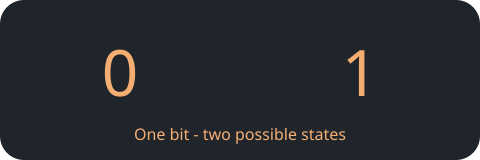

# Elgo Lab

A bilingual learning platform built with vanilla JavaScript, Node.js and Cloudflare Pages Functions. This public edition ships **one original demo course, 12 questions across four collections, one lecture guide and one synthetic PDF**. Private university content and deployment configuration are not part of this repository.



## Explore locally

Use a current Node 22 LTS release or newer with `node:sqlite` available. There are no runtime npm dependencies.

```sh
npm run build
npm run check
npm test
npm run dev
```

Open http://127.0.0.1:4183/?flow=hub. Explore Study, Practice, ranked tests, English/Arabic explanations, the lecture page and PDF library. The Admin Portal supports content editing, image uploads and live presence. Offline HTML downloads depend on the admin's download settings. The dev server uses temporary in-memory data; use self-hosting for persistence.

The local admin password is `0000` on loopback only. Binding the dev server to another host requires `ELGO_DEV_ADMIN_PASSWORD` of at least 12 characters. Use a long random value. Custom passwords are not printed to logs.

## Cloudflare Pages

Connect your fork with Git integration. Use these settings:

| Setting | Value |
| --- | --- |
| Framework preset | None |
| Build command | `npm run build` |
| Output directory | `public` |
| Root directory | Repository root |
| Build environment | `NODE_VERSION=22` |
| D1 binding | `DB` pointing to your database |
| R2 binding | `FILES` pointing to your bucket |
| Encrypted secret | `ADMIN_PASSWORD_HASH` |

For a **new empty D1 database**, initialize from `backend/schema.sql`. Do not blindly apply legacy migrations 0001-0003 after the complete schema. They exist for older installations. Generate a password hash locally using `node tools/admin-password.js --hash`, then enter the resulting hash as the Pages secret. Set bindings for each deployment environment you use and redeploy for them to take effect.

Configure bindings in the Dashboard, or copy `wrangler.example.toml` to ignored `wrangler.toml` and replace its placeholders with your own resources. Never commit real configuration, passwords or tokens. `public/` is generated on each build and is ignored by Git.

Official references: [Git integration](https://developers.cloudflare.com/pages/get-started/git-integration/) and [D1/R2 bindings](https://developers.cloudflare.com/pages/functions/bindings/).

## VPS / Docker

For Node hosting, copy `.env.example` to `.env`, configure `ADMIN_PASSWORD_HASH`, run `npm run build`, then `npm start`. Put the server behind an HTTPS reverse proxy and persist/back up `ELGO_DATA_DIR` (default `data-store`). Set `TRUST_PROXY=1` only behind a trusted proxy.

For Docker, configure the same `.env` file and run:

```sh
docker compose up --build -d
```

The named `elgo_data` volume stores SQLite and uploaded files. Port 4183 is published; restrict network access appropriately and terminate HTTPS at your reverse proxy.

## Validation and responsive review

GitHub Actions runs `npm run check` and `npm test` on Node 22 for pushes and pull requests. The build gate checks that canonical content, the catalog and the backend answer key agree. See [responsive review checklist](docs/RESPONSIVE.md) for the required viewport/language/theme matrix and current verification limits.

The preparation environment passed build/check. Full test execution is not yet verified: two HTTP integration tests cannot connect to localhost in that environment. Screenshots are not included because the browser session could not be opened; this is not a completed visual review.

## License and content

The platform code is MIT licensed; the bundled original demo material is also MIT licensed for educational reuse. See [LICENSE](LICENSE) and [content licensing](content/README.md). Add only content you have permission to distribute. See [content prompts](docs/PROMPTS.md) and [contributing](CONTRIBUTING.md).
